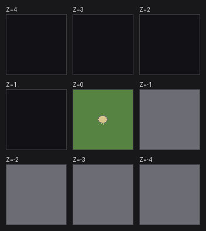

# 把 v53 的「Small arena（小型竞技场）」移植到 v0.47.05

## 结论先说

| 文件 | 地面层 | 下方 | 上方 |
|---|---|---|---|
| **`47_small_arena.txt`** | **Z=0**：整层草地 + 中央场地 | `Z=-1…-4` 实心岩壁 `P` | `Z=1…4` 空地 `#` |
| `47_small_arena_z-4.txt` | Z=-4：整层草地 + 中央场地 | （已是最底层） | 其余 8 层全空 `#` |
| **`47_grass_only.txt`** | **Z=-4**：整层纯草地 `g`（无墙无沙，20736 格全 `g`） | （已是最底层） | `Z=-3…4` 全空 `#` |

主推 `47_small_arena.txt`：进竞技场就是场地那一层，下面压着实心岩壁，和原版 `arena.txt`
「上面是地表、下面是实心岩」的构造保持一致。

`47_grass_only.txt` 是「干净版」：最底层整层草地、不要场地也不要地下填充，看着不眼花的代价是
进图后要按 4 下下降键下到 Z=-4 才看得到草地。

用法：改名成 `arena.txt`，覆盖 v0.47.05 游戏目录的 `data\init\arena.txt`（**先备份原文件**），
重启游戏进入 Object Testing Arena。

因为 0.47 的竞技场尺寸是**写死的 144×144、9 个 Z 层**，没法改成 48×48，所以做法是：
把 53 版那块 48×48 的区域**原样、逐格**放进 144×144 地图的正中央（第 48–95 列 / 第 48–95 行），
外面整层铺草地。



---

## 一、两份文件到底差在哪

| | v53（`53_arena.txt`） | v0.47（`47_arena.txt`） |
|---|---|---|
| 结构 | 一个文件里装多张图：`[ARENA:SMALL]`、`[ARENA:FOREST]`、`[ARENA:CLASSIC]` | 一个文件 = 一张图，没有分段 |
| 尺寸 | 每张图自己声明：`[DIMX:48]` `[DIMY:48]` | 固定 144×144，不能改 |
| 层数 | `[MAP_LEVEL]` 若干层，`[REPEAT_LAST_MAP_LEVEL]` 表示重复上一层 | 固定 9 层，`Z=-4` 到 `Z=4`，每层必须写满 144 行 |
| 起始位置 | `[START_CENTER:23:23:0]` 显式指定 x : y : **层序号** | **没有这个字段** |
| 行首标记 | `[ARENA:…]` 这种方括号标签 | `Z=-4, Lowest Level (must leave this line here)` 这类纯文本行 |

所以「不能直接复制」的真正原因是**外层语法和画布尺寸不同**，不是内容不同。

## 二、瓦片字符的含义没有变（这一点做过验证）

我拿 53 文件里的 `[ARENA:CLASSIC]` 和 47 的默认 `arena.txt` 做了逐格比对：
**9 层 × 144 × 144 全部完全一致，0 处不同**。
CLASSIC 在 53 里就是「和老版本一样的经典竞技场」，而它和 47 的默认图一模一样，
这就证明了从 47 到 53，地图字符（`# . P R F C + W w L l g T ~ ,`）的含义一路没改。

于是转换只需要做「重新排版」，字符照抄：

| 字符 | 含义 | 在小型竞技场里出现的位置 |
|---|---|---|
| `g` | 草地（有地板） | 整片场地 + 场地外填充 |
| `P` | 石块墙 | 中间椭圆场地的围墙；以及地面层以下的实心岩 |
| `~` | 沙地（地板） | 椭圆场地内部 + 南侧出口的一小段 |
| `#` | 空地（无地板） | 地面层以上的空层 |

（不是水。DF 里水是 `W`，`~` 是沙。所以那圈东西是沙地竞技场，不是水池。）

## 三、镜头问题的根因，以及 47 原版是怎么做的

**v0.47 的 `arena.txt` 里没有任何「起始镜头 / 起始层」的设置。**
引擎进入竞技场时固定从 9 层的中层、也就是 `Z=0` 开图。

于是原版文件的做法其实很朴素：**它把"能用"的东西全都摆在 Z=0 附近**。
`data/init/arena.txt` 里 Z=-4～-1 基本是实心岩壁、水、岩浆，Z=0 才是草地/土层/竞技场地面，
Z=1～4 基本是空 —— 你进图正好站在竞技场这一层，不是因为它指定了起点，
而是因为**它的地表本来就长在引擎固定的起点上**。

v53 就不一样了：v50+ 把起始位置变成了可配置项，`[START_CENTER:23:23:0]` 末尾那个 `0` 是**层序号**
（0 = 第 1 个 `[MAP_LEVEL]`）。这也解释了为什么小型竞技场在 53 里可以把地面放在最低层 `Z=-4`
却依然一进图就看到它 —— 它把起点指到了那一层。**47 没有这个机制，所以做不到。**

结论：想在 0.47 里一进图就看到场地，草地那层就**只能**放在 `Z=0`。
这不是文件写得不对，是 47 引擎的硬限制。

## 四、关于「草地需要下面的墙托着」

严格说 DF 的地板是**独立存在**的：一块有地板的格子，下面即使是空地也不会塌，
竞技场里也没有挖矿坍塌这回事。所以早先那版「下面全空」其实也能正常站着走。

但你的直觉方向是对的，而且**照原版填实心岩更稳妥、更像正常地形**：

- 往下看/往下挖时不会出现一层悬空的草地；
- 和原版 `arena.txt` 的构造一致（原版 Z=0 下面就是大片实心岩、水、岩浆）；
- 万一某个版本对「无支撑地表」有额外处理，也不会碰到。

所以现在的 `47_small_arena.txt`：`Z=-1…-4` 全是 `P`（实心岩壁），`Z=1…4` 是 `#`（天空）。

## 五、生成的文件长什么样

9 层，`Z=-4` 到 `Z=4`，每层 144 行 × 144 字符，CRLF 换行、纯 ASCII、末尾不带换行
（和原版 `47_arena.txt` 的字节结构完全一致：189529 字节 / 1305 行）。

`47_small_arena.txt`（推荐）：

| 层 | 内容 |
|---|---|
| `Z=4 … Z=1` | `#` 空地（20736 格全空） |
| `Z=0` | 20405 格 `g` + 73 格 `P` + 258 格 `~`：整层草地，中间是场地 |
| `Z=-1 … Z=-4` | `P` 实心岩壁（20736 格全实心） |

`47_grass_only.txt`（纯草地版）：

| 层 | 内容 |
|---|---|
| `Z=4 … Z=-3` | `#` 空地（每层 20736 格全空） |
| `Z=-4` | `g` 草地（20736 格全草地，没有任何墙体和沙地） |

## 六、怎么验证（都在这次交付里跑过）

```
python convert_arena.py --list      # 列出 53 文件里的三张图
python convert_arena.py --selftest  # 交叉验证 + 逐格比对
python make_preview.py              # 校验两份成品 + 出预览图
```

`convert_arena.py --selftest` 会做两件事：

1. 把 53 的 CLASSIC 和 47 默认图对齐比较 → 9 层全部 0 差异（证明字符含义一致）；
2. 把生成结果重新解析回来，检查 9 层 / 144×144 / 内部 48×48 与源文件逐格比对 → 0 差异。

`make_preview.py` 对两份成品分别检查：内部 48×48 与源差异 0 格、地面层场地外非草地 0 格、
地面层以上非 `#` 0 格、地面层以下非指定填充 0 格。

## 七、安装步骤（v0.47.05）

1. 关掉游戏。
2. 备份 `Dwarf Fortress\data\init\arena.txt`（比如改名成 `arena.txt.bak`）。
3. 把 `47_small_arena.txt` 复制进去，改名为 `arena.txt`。
4. 启动游戏 → Object Testing Arena → 直接就是场地。

注意：竞技场的初始地形只在**游戏启动时**读一次，所以必须重启游戏才生效；
在竞技场里用手改的地形不会写回 `arena.txt`。

## 八、已知的取舍 / 可以再改的地方

- 受 0.47 固定 144×144 的限制，场地只有中间 48×48，外面那一大圈是同色草地。
  想换外观用 `--fill` 指定地面层填充字符，例如 `--fill P` 铺成石地。
- 下方填充可用 `--below` 控制（默认 `#`，主推文件用的是 `--below P`）。
- `--flat` 是「只要纯色地面」模式：不铺任何竞技场内容，整层用 `--fill` 指定的字符铺满。
  `47_grass_only.txt` 就是 `--anchor 4 --flat --fill g` 生成的。
- `~` 沙地在游戏里每次进入会随机选一种沙/土壤的材质，这是 DF 本身的行为（wiki 也这么写）。
- 想生成别的层位：`--anchor N` 表示「竞技场自身第 N 层放到 Z=0」，`--anchor 4` 就是那份 `Z=-4` 版本。

## 九、文件清单

| 文件 | 说明 |
|---|---|
| `47_small_arena.txt` | **推荐成品**：Z=0 草地 + 场地，下方实心岩，上方空层 |
| `47_small_arena_z-4.txt` | 层号照抄 53 的版本：场地在 Z=-4，其余全空，需下降 4 层 |
| `47_grass_only.txt` | 纯草地版：Z=-4 整层 `g`，无墙无沙，上方 8 层全空 |
| `convert_arena.py` | 转换脚本：`--anchor` 层位、`--fill` 地面填充、`--below` 地下填充、`--flat` 纯色模式 |
| `make_preview.py` | 校验 + 出预览图 |
| `preview_layers.png` | 九层剖面总览 |
| `preview_layers_grass.png` | 纯草地版的九层剖面 |
| `preview_z0.png` / `preview_zm4.png` | 源图与两份成品并排的俯视图 |
| `preview_crop_check_z0.png` / `_zm4.png` | 成品中央 48×48 与源图逐格对照 |
